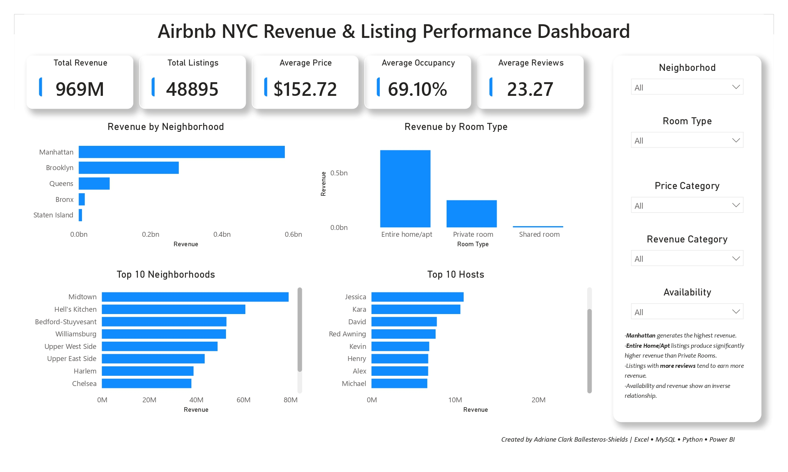

# Airbnb NYC Revenue & Listing Performance Analysis
---

## Dashboard Preview




---

## Project Overview

This project analyzes Airbnb listings in New York City to uncover revenue drivers, pricing patterns, host performance, and neighborhood profitability. The goal is to transform raw Airbnb data into actionable business insights through Excel, MySQL, Python, and Power BI.

The project follows a complete end-to-end data analytics workflow, including data cleaning, exploratory analysis, SQL querying, business intelligence reporting, and dashboard development.

---

## Business Problem

Airbnb operates across thousands of listings with varying prices, occupancy rates, room types, and host performance. Understanding which factors contribute to higher revenue and stronger listing performance is essential for both Airbnb and property hosts.

This project aims to answer the following business questions:

* Which borough generates the highest revenue?
* Which room type contributes the most to revenue?
* Which neighborhoods are the most profitable?
* Who are the highest-performing hosts?
* How do pricing and availability impact listing performance?
* What opportunities exist to maximize revenue and occupancy?

---
# 🏙️ Airbnb Listings Analysis – New York City

An analysis of 48,895 Airbnb listings across New York City's five boroughs, covering pricing, room types, availability, demand, host concentration and neighbourhood patterns.

---

## 🎯 Project Overview

This project explores a raw Airbnb listings dataset to answer five questions:

1. Where are the listings, and what types of rooms are offered?
2. How do prices differ by borough, neighbourhood and room type?
3. Where is demand strongest, based on reviews and recent activity?
4. How concentrated is supply among a small number of hosts?
5. What should hosts, investors and platform managers do with these insights?

---

## 🗂️ Dataset

| Item | Details |
|---|---|
| Listings | 48,895 (37,457 unique hosts) |
| Geography | 5 boroughs, 221 neighbourhoods, with latitude and longitude |
| Room types | Entire home/apt, Private room, Shared room |
| Snapshot | The most recent review is dated 8 July 2019 |
| Source columns | `id`, `name`, `host_id`, `host_name`, `neighbourhood_group`, `neighbourhood`, `latitude`, `longitude`, `room_type`, `price`, `minimum_nights`, `number_of_reviews`, `last_review`, `reviews_per_month`, `calculated_host_listings_count`, `availability_365`, `revenue_estimate` |

**Missing values:** 10,052 listings (20.6%) have no reviews and therefore no `last_review` or `reviews_per_month`. A further 16 listings have no name and 21 have no host name. There are no duplicate records.

> **Important:** `revenue_estimate` equals `price × availability_365` for every row. It measures the **revenue potential if every available night were booked**, not actual earnings, so it is treated as a potential-revenue indicator throughout this report.

---

## 🔧 Approach

1. **Validation:** checked missing values, duplicates, price and minimum-night outliers, and how `revenue_estimate` is calculated.
2. **Feature creation:** defined an "active" listing as one with a review in the 12 months before the latest review date, and built a demand index (`price × reviews_per_month`) as a more realistic alternative to `revenue_estimate`.
3. **Exploration:** compared price, availability, reviews and potential revenue by borough, neighbourhood, room type, host size and price band.
4. **Statistical testing:** Kruskal–Wallis tests and Spearman correlations, using a 5% significance level.

**Tools:** Python (pandas, SciPy).

---

## 📊 Key Findings

### Headline numbers

| Metric | Value |
|---|---|
| Listings | 48,895 |
| Median / mean price per night | 106 / 153 |
| Entire homes / Private rooms / Shared rooms | 52.0% / 45.7% / 2.4% |
| Average availability | 112.8 days per year |
| Listings with zero availability | 17,533 (35.9%) |
| Active listings (reviewed in last 12 months) | 29,152 (59.6%) |
| Listings requiring a 30+ night stay | 4,507 (9.2%) |
| Total potential revenue (`revenue_estimate`) | about 968.6 million |

### By borough

| Borough | Listings | Share | Median price | Avg. availability (days) | Median reviews / month | Active listings |
|---|---|---|---|---|---|---|
| Manhattan | 21,661 | 44.3% | 150 | 112 | 0.61 | 55.3% |
| Brooklyn | 20,104 | 41.1% | 90 | 100 | 0.66 | 60.8% |
| Queens | 5,666 | 11.6% | 75 | 144 | 1.21 | 68.4% |
| Bronx | 1,091 | 2.2% | 65 | 166 | 1.38 | 71.6% |
| Staten Island | 373 | 0.8% | 75 | 200 | 1.41 | 80.4% |

### By room type

| Room type | Listings | Median price | Share of potential revenue |
|---|---|---|---|
| Entire home/apt | 25,409 | 160 | 73.1% |
| Private room | 22,326 | 70 | 25.7% |
| Shared room | 1,160 | 45 | 1.2% |

### Insights

- **Supply is concentrated in Manhattan and Brooklyn.** Together they hold 85.4% of listings. Williamsburg (3,920), Bedford-Stuyvesant (3,714) and Harlem (2,658) are the three largest neighbourhoods, and the top 10 neighbourhoods account for 48.0% of all listings.
- **Location and room type drive price.** Median prices range from 65 in the Bronx to 150 in Manhattan, and from 45 for a shared room to 160 for an entire home (both p < 0.001). The pattern holds within each room type, for example entire homes cost a median of 191 in Manhattan vs 100 in the Bronx and Staten Island.
- **Tribeca and Midtown are the most expensive areas** (median 295 and 210), while Borough Park, Elmhurst, East Elmhurst, Ridgewood and Woodside are cheapest (about 53–60) among neighbourhoods with 100+ listings.
- **Manhattan and entire homes dominate revenue potential.** Manhattan accounts for 59.5% of `revenue_estimate` and entire homes for 73.1%. Using the review-based demand index instead, the picture is similar (Manhattan 52.0%, Brooklyn 34.7%, Queens 10.9%; entire homes 70.0%), so the conclusion does not depend on the way revenue is estimated.
- **Outer boroughs show stronger booking activity per listing.** Queens, the Bronx and Staten Island have roughly double the median reviews per month of Manhattan and Brooklyn (1.2–1.4 vs 0.6–0.7, p < 0.001), and a larger share of listings are active. These areas have lower prices, so the smaller markets may be under-supplied.
- **Many listings look inactive or unavailable.** 35.9% have zero availability, 40.4% have had no review in the past year, and 2,718 inactive listings still show 300+ days of availability, which suggests stale or unused listings.
- **Higher prices come with higher availability, not higher demand.** Listings above 500 per night are available 185 days per year on average vs about 100–107 days for those at or below 150, and price has almost no relationship with reviews (Spearman ρ = −0.06).
- **A small group of hosts holds a large share of supply.** 13.8% of hosts operate multiple listings but control 33.9% of all listings. 115 hosts with 10+ listings hold 6.5%, led by Sonder (NYC) with 327 and Blueground with 232 listings. Listings from multi-listing hosts are available 179 days per year vs 79 for single-listing hosts.
- **Reviews are heavily concentrated.** The top 10% of listings generate 57.2% of all reviews, while 20.6% of listings have none.
- **Long minimum stays are a niche.** 9.2% of listings require 30+ nights (13.0% in Manhattan), and 14 listings require more than a year.
- **Price outliers need cleaning.** 11 listings have a price of 0, 298 are priced at 1,000 or more, and three listings are priced at 10,000.

---

## ✅ Recommendations

**For hosts**
1. **Price against comparable listings, not the market average.** Use borough, neighbourhood and room-type medians as a starting point (for example, entire homes in Manhattan have a median of 191).
2. **Do not assume a higher price brings more bookings.** Price shows no relationship with review activity, so test price changes and track actual bookings.
3. **Refresh or remove inactive listings.** Update calendars, photos and prices for listings with long availability but no recent reviews.

**For investors and operators**
4. **Consider outer-borough opportunities.** Queens, the Bronx and Staten Island show higher reviews per listing and active-listing rates with lower entry prices, but verify demand with actual booking data first.
5. **Favour entire homes in high-demand areas for revenue,** and private rooms for lower-cost entry, since entire homes generate about 70% of both potential revenue and demand-weighted revenue.
6. **Check regulatory exposure before investing.** 45.5% of all listings are entire homes with minimum stays under 30 days; short-term rental rules, such as New York City's 2023 enforcement, may affect these. Confirm current requirements.

**For platform managers and analysts**
7. **Monitor professional hosts.** Hosts with 10+ listings and very high availability may operate more like commercial businesses, which affects housing supply and policy discussions.
8. **Clean and flag data issues.** Remove or review zero-price and extreme-price listings, extreme minimum nights (up to 1,250), and listings with no activity.
9. **Replace `revenue_estimate` with a demand-based measure.** Combine price, estimated occupancy from reviews, and length of stay to estimate real revenue rather than potential revenue.
10. **Add time-series data.** Monthly bookings, occupancy and price history would allow analysis of seasonality and trends, which a single snapshot cannot provide.

---

## 🏁 Conclusion

The New York City Airbnb market is **concentrated by location and room type**: Manhattan and Brooklyn hold 85% of listings, and entire homes bring in around 70% of revenue potential and demand. Price is largely explained by borough and room type, but **higher prices do not bring more bookings**, and a large share of listings (36% with zero availability, 40% with no recent reviews) appear inactive. At the same time, outer boroughs show stronger booking activity per listing and a small group of professional hosts controls a sizeable share of supply. The most useful next steps are to price by comparable listings, refresh or remove inactive listings, explore under-supplied outer-borough markets, and replace the potential-revenue estimate with a booking-based measure.

---

## ⚠️ Limitations

- **`revenue_estimate` is not actual revenue.** It is price multiplied by availability, so it rewards listings that are available more days and gives zero for the 35.9% of listings with no availability.
- **Reviews are only a proxy for demand.** Not every guest leaves a review, and review rates differ between listings.
- **A single snapshot.** The data is dated around mid-2019, so it cannot show trends or seasonality, and it predates later market and regulatory changes. Results may not reflect today's market.
- **Price is a listed price.** It may differ from the price actually paid, and it excludes cleaning fees, discounts and dynamic pricing.
- **No ratings, amenities, property size or photos.** These strongly affect price and demand, so price differences are only partly explained by location and room type.
- **Outliers and data issues.** Extreme prices (0 and up to 10,000) and minimum nights (up to 1,250) can distort averages, which is why medians are used for prices.
- **Associations, not causes.** The relationships between price, availability and reviews are observational.
---

## Dataset

**Source:** Airbnb NYC Listings Dataset

**Records:** 48,895 Listings

**Features:**

* Listing Information

  * ID
  * Listing Name
  * Room Type

* Host Information

  * Host ID
  * Host Name
  * Number of Listings

* Location Information

  * Neighbourhood
  * Neighbourhood Group (Borough)
  * Latitude
  * Longitude

* Performance Metrics

  * Price
  * Minimum Nights
  * Number of Reviews
  * Reviews Per Month
  * Availability (365 Days)
  * Estimated Revenue

---

## Project Workflow

### 1. Data Cleaning (Excel)

* Converted raw dataset into structured tables
* Handled missing values
* Created calculated fields:

  * Revenue Category
  * Price Category
  * Availability Category
  * Occupancy Rate
* Validated data types and formatting

### 2. Database Analysis (MySQL)

* Imported cleaned dataset into MySQL
* Performed exploratory SQL analysis
* Used aggregations, filtering, ranking, and window functions
* Analyzed revenue, occupancy, pricing, and host performance

### 3. Exploratory Data Analysis (Python)

* Data profiling and validation
* Revenue analysis
* Occupancy analysis
* Correlation analysis
* Host and neighborhood performance evaluation

Libraries Used:

* Pandas
* NumPy
* Matplotlib

### 4. Business Intelligence Dashboard (Power BI)

Developed an executive dashboard featuring:

* Revenue KPIs
* Listing KPIs
* Occupancy KPIs
* Revenue by Borough
* Revenue by Room Type
* Top Revenue Neighborhoods
* Top Revenue Hosts
* Interactive Slicers


## Tools

| Tool     | Purpose                           |
| -------- | --------------------------------- |
| Excel    | Data Cleaning & Transformation    |
| MySQL    | Data Querying & Analysis          |
| Python   | Exploratory Data Analysis         |
| Power BI | Dashboard Development             |
| GitHub   | Project Documentation & Portfolio |

---

## Project Structure

```text
Airbnb-NYC-Analysis/
│
├── data/
│   └── airbnb_datasheet_raw.csv
│   └── airbnb_cleaned_final.csv
│
├── excel/
│   └── airbnb_datasheet.xlsx
│
├── powerbi/
│   ├── dash.pbix
│   └── dash.jpg
│   └── dash.pdf
│
├── python/
│   └── airbnb_analysis.ipynb
│
├── sql/
│   └── queries.sql
│
└── README.md

```


## 👤 Author

Adriane Clark Ballesteros  
Data Analyst Trainee

* 🔗 GitHub: https://github.com/acbshields12
* 🔗 Linkedin: https://www.linkedin.com/in/acsballesteros12/
* 🔗 Portfolio Website: https://acbshields12.github.io/

---

